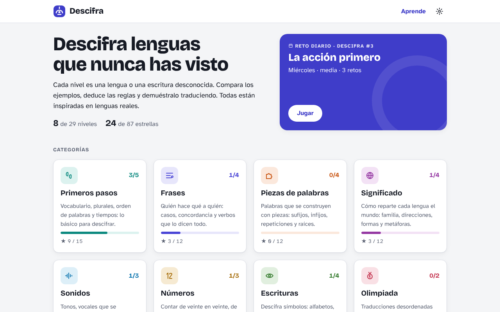
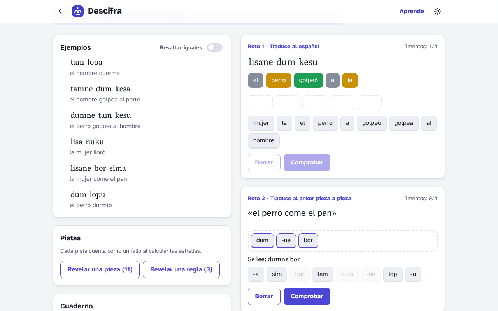
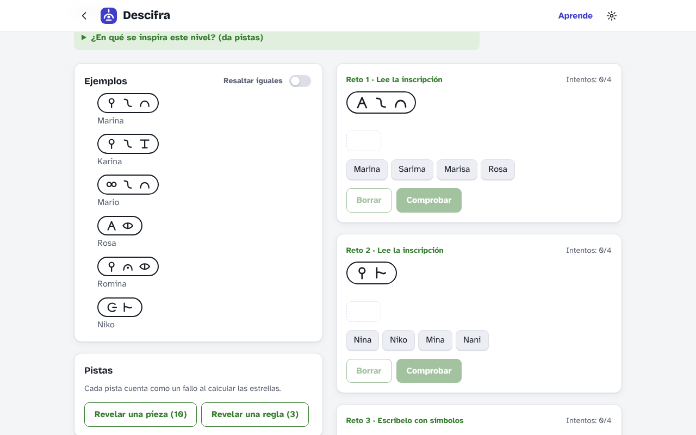
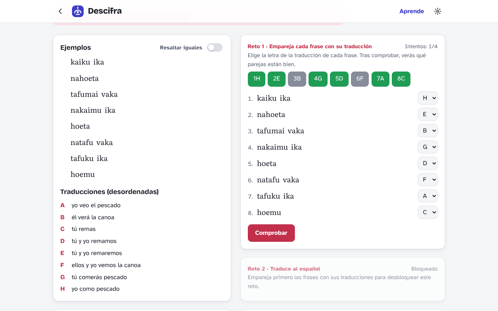
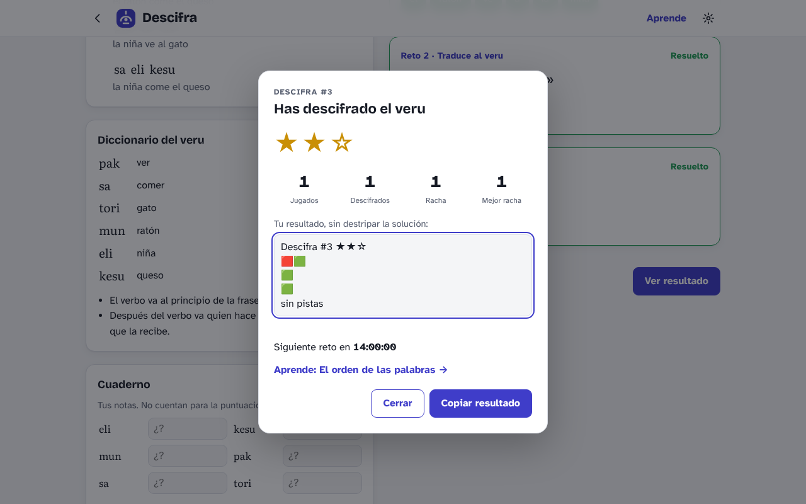
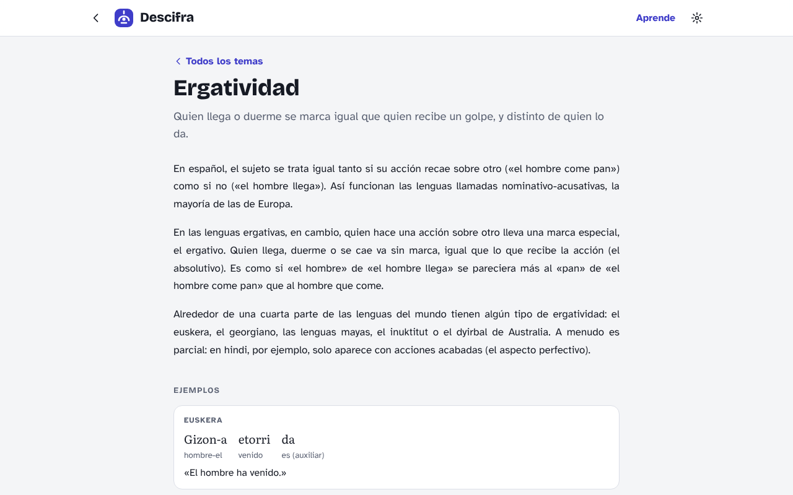
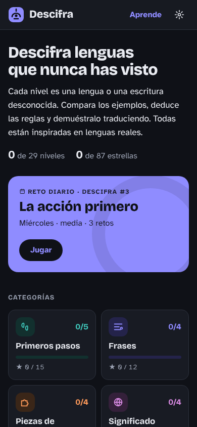
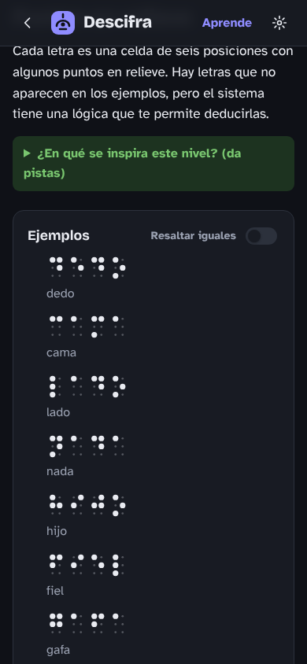

# Descifra

**[Jugar ahora →](https://carlos-vi.github.io/Descifra-game/)**



**Descifra** es un juego de lógica en el navegador en el que hay que descifrar lenguas
y escrituras que nunca has visto. Cada nivel presenta unas frases de ejemplo con su
traducción; a partir de ellas hay que deducir el vocabulario y la gramática, y
demostrarlo resolviendo retos de traducción.

Todas las lenguas del juego son inventadas, pero cada una está inspirada en fenómenos
de lenguas reales: la ergatividad del euskera, las clases nominales del suajili, los
tonos del chino, la numeración maya, los jeroglíficos egipcios… El juego incluye una
sección para aprender sobre ellos con ejemplos reales.

## Índice

- [Cómo se juega](#cómo-se-juega)
- [Modos de juego](#modos-de-juego)
- [Capturas](#capturas)
- [Niveles](#niveles)
- [Sección Aprende](#sección-aprende)
- [Ejecutar el juego](#ejecutar-el-juego)
- [Estructura del proyecto](#estructura-del-proyecto)
- [Cómo está hecho](#cómo-está-hecho)
- [Añadir contenido](#añadir-contenido)
- [Tests](#tests)
- [Despliegue](#despliegue)
- [Sobre las lenguas del juego](#sobre-las-lenguas-del-juego)
- [Licencia](#licencia)

## Cómo se juega

1. **Observa los ejemplos.** Cada nivel muestra frases en la lengua desconocida con su
   traducción. Busca lo que se repite: palabras, sufijos, el orden de las palabras.
2. **Toma notas.** El cuaderno de cada nivel tiene un hueco para cada palabra y un
   espacio de notas libres. No cuenta para la puntuación.
3. **Resuelve los retos.** Hay varios tipos:
   - *Traducir al español* o *a la lengua*, pulsando fichas en orden.
   - *Traducir pieza a pieza*: las fichas son raíces y afijos sueltos. Las piezas como
     `ni-` se unen a lo que va detrás y las como `-ne`, a lo que va delante. La
     longitud de la respuesta no se da: si faltan o sobran piezas, el juego avisa.
   - *Escribir con símbolos*, en los niveles de escrituras.
   - *Preguntas de opción múltiple* sobre una regla o para encontrar la frase incorrecta.
   - *Emparejar traducciones desordenadas*, en los niveles de Olimpiada. Los demás retos
     se desbloquean al terminar este.
4. **Interpreta los colores.** Tras cada intento, las fichas se colorean como en Wordle:
   verde (correcta y en su sitio), amarillo (va, pero en otro sitio) y gris (no va).
5. **Usa las pistas si hace falta.** Se puede revelar el significado de una pieza o una
   regla gramatical.

Cada reto tiene 4 intentos (2 en las preguntas de opción múltiple). Se empieza con 3
estrellas y cada fallo o pista resta; si se agotan los intentos de un reto, el nivel
acaba sin estrellas. Al terminar se muestra la solución completa, con el análisis de
cada frase pieza a pieza, y en qué lenguas reales se inspira el nivel.

El interruptor **«Resaltar iguales»** de cada nivel marca todas las apariciones de la
palabra o el símbolo que se señala. Está desactivado por defecto y la elección se
recuerda para todos los niveles.

## Modos de juego

### Reto diario

Una lengua nueva cada día, la misma para todos los jugadores, numerada como
«Descifra #N». Como el crucigrama del New York Times, **el lunes es el más fácil y el
domingo el más difícil**. Se juega una sola vez al día; al terminar se puede copiar un
resumen del resultado que no desvela la solución:

```
Descifra #12 ★★☆
🟥🟩
🟩
🟩
sin pistas
```

Se guardan la racha de días seguidos, la mejor racha y las estadísticas. Hay 14 retos
diarios, dos por cada día de la semana, que se van turnando.

### Categorías

29 niveles organizados en ocho categorías, cada uno con una dificultad de 1 a 5.
Se pueden jugar en cualquier orden y reiniciar cuando se quiera.

## Capturas

<table>
  <tr>
    <td width="50%"></td>
    <td width="50%"></td>
  </tr>
  <tr>
    <td><b>Un nivel en curso.</b> Tras cada intento, las fichas se colorean; en los retos «pieza a pieza» se ve cómo se lee lo que vas construyendo.</td>
    <td><b>Escrituras.</b> Sílabas dentro de cartuchos que se leen de derecha a izquierda, como en el método de Champollion.</td>
  </tr>
  <tr>
    <td></td>
    <td></td>
  </tr>
  <tr>
    <td><b>Olimpiada.</b> Primero hay que emparejar las frases con sus traducciones desordenadas.</td>
    <td><b>Reto diario.</b> Estadísticas, racha y un resumen para compartir sin desvelar la solución.</td>
  </tr>
  <tr>
    <td></td>
    <td align="center"> </td>
  </tr>
  <tr>
    <td><b>Aprende.</b> Artículos con ejemplos de lenguas reales analizados palabra a palabra.</td>
    <td><b>En el móvil</b>, con tema claro u oscuro según el sistema.</td>
  </tr>
</table>

## Niveles

| Categoría | Nivel | Dificultad | Inspirado en |
|---|---|:-:|---|
| **Primeros pasos** | Primeras palabras |  | Lenguas sin artículos (ruso, chino, japonés) |
| | Más de uno |  | Plural con sufijo (turco, húngaro) |
| | El verbo al final |  | Orden sujeto-objeto-verbo (japonés, turco, euskera) |
| | Ayer y mañana |  | Tiempo con palabras sueltas (vietnamita, indonesio) |
| | La gran prueba |  | Adjetivo delante y verbo al final (japonés, turco) |
| **Frases** | ¿Sí o no? |  | Responder repitiendo el verbo (irlandés, finés) |
| | Quien hace y quien sufre |  | Ergatividad (euskera) |
| | Todo concuerda |  | Clases nominales (suajili) |
| | Yo te veo |  | Verbos con sujeto y objeto (suajili, náhuatl) |
| **Piezas de palabras** | Uno, dos, muchos |  | Número dual (esloveno, árabe, inuktitut) |
| | Piezas por dentro |  | Infijos y reduplicación (tagalo) |
| | Dicen que… |  | Evidencialidad y posesión (quechua, húngaro) |
| | Tres consonantes |  | Raíces de tres consonantes (árabe, hebreo) |
| **Significado** | Palabras que se juntan |  | Compuestos y kennings (alemán, chino) |
| | Contar cosas |  | Clasificadores (japonés, chino) |
| | Sin izquierda ni derecha |  | Direcciones absolutas (guugu yimithirr) |
| | La familia de Ana |  | Parentesco iroqués |
| **Sonidos** | Las vocales mandan |  | Armonía vocálica (turco, finés) |
| | Cantar las palabras |  | Tonos (chino mandarín, yoruba) |
| | Lenguas hermanas |  | Cambios fonéticos regulares (latín → español, ley de Grimm) |
| **Números** | Puntos y barras |  | Numeración maya (base 20) |
| | Contar restando |  | Números que restan (yoruba, latín) |
| | Cuentas antiguas |  | Base 6 (ndom), con traducciones desordenadas |
| **Escrituras** | Un alfabeto nuevo |  | Alfabeto rúnico, cifrado por sustitución |
| | Puntos en relieve |  | Braille |
| | Nombres en cartuchos |  | Champollion y los silabarios (se lee de derecha a izquierda) |
| | Dibujos que suenan |  | Jeroglíficos egipcios con determinativos |
| **Olimpiada** | Tú y yo |  | «Nosotros» inclusivo y exclusivo (indonesio, quechua) |
| | Las huellas del río |  | Ergatividad del dyirbal |

## Sección Aprende

21 artículos que explican los fenómenos de los niveles con ejemplos de lenguas reales,
analizados palabra a palabra. Cada uno incluye una lista de lenguas que lo usan, enlaces
para saber más y los niveles donde se practica:

El orden de las palabras · Responder sin «sí» ni «no» · Palabras hechas de piezas ·
Uno, dos, muchos · Armonía vocálica · Lenguas tonales · Lenguas hermanas · Palabras
compuestas · Ergatividad · Clases nominales · Verbos que lo dicen todo · ¿Cómo lo
sabes? · ¿Quién marca la posesión? · Dos maneras de decir «nosotros» · Sistemas de
parentesco · Clasificadores · Norte, sur, este y oeste · Contar de otra manera · El
tiempo sin conjugar · Más allá de los sufijos · Escrituras del mundo.

Los enlaces externos llevan a la búsqueda de Wikipedia en español del término, que abre
directamente el artículo cuando existe.

## Ejecutar el juego

La forma más rápida de jugar es la versión publicada: **https://carlos-vi.github.io/Descifra-game/**

Para ejecutarlo en tu ordenador no hace falta instalar nada: es HTML, CSS y JavaScript
sin dependencias.

```
git clone https://github.com/carlos-vi/Descifra-game.git
cd Descifra-game
```

- **La forma más sencilla:** abre `index.html` con doble clic en cualquier navegador.
- **Con un servidor local** (útil durante el desarrollo):

  ```
  npm start
  ```

  y abre <http://localhost:8000>. Este comando usa `python3 -m http.server`.

Las tipografías se cargan desde Google Fonts; sin conexión, el juego funciona igual con
las tipografías del sistema.

El progreso, las notas, las estadísticas y los ajustes se guardan en el `localStorage`
del navegador, así que son propios de cada navegador y cada dispositivo.

## Estructura del proyecto

```
index.html            página principal
css/style.css         estilos (temas claro y oscuro, adaptados a móvil)
js/engine.js          lógica del juego, sin DOM: corrección, puntuación, pistas,
                      análisis de palabras, reto diario y estadísticas
js/categories.js      las ocho categorías de niveles
js/puzzles.js         los 29 niveles y la descripción de su formato
js/daily-puzzles.js   los 14 retos diarios
js/scripts.js         los glifos de las escrituras inventadas, dibujados en SVG
js/learn.js           los artículos de la sección Aprende
js/ui.js              la interfaz: pantallas, fichas, guardado y ajustes
tests/engine.test.js  tests automáticos
package.json          comandos npm test y npm start
```

## Cómo está hecho

- **Datos separados de la lógica.** Cada nivel es un objeto de datos; el motor
  (`engine.js`) no sabe nada de la página y se prueba con Node.
- **Navegación por la dirección.** Cada pantalla tiene su propia dirección: `#hoy`
  (reto diario), `#cat-frases` (una categoría), `#ankor` (un nivel), `#aprende` y
  `#aprende-ergatividad` (un artículo).
- **Fichas deterministas.** Las fichas y las opciones se barajan con una semilla que
  depende del nivel, así que todos los jugadores ven el mismo orden.
- **Análisis morfológico.** El motor sabe dividir palabras en prefijos, raíces, sufijos,
  infijos (`<um>`) y reduplicación (`~`), y unir piezas para mostrar cómo se lee una
  respuesta.
- **Escrituras de glifos.** Cada escritura define sus glifos como dibujos SVG. Se pueden
  leer de derecha a izquierda, apilar en vertical (los números mayas) o enmarcar en
  cartuchos. Las escrituras «composicionales» (braille, mayas) generan el glifo a partir
  de su estructura, así que un reto puede pedir un símbolo que no aparece en los ejemplos.

## Añadir contenido

### Un nivel

Añade un objeto a `js/puzzles.js`. El formato completo está descrito al principio del
archivo. Este ejemplo está abreviado; un nivel real necesita varias frases de ejemplo
para que cada pieza se pueda deducir comparándolas:

```js
{
  id: 'ejemplo',                // solo letras minúsculas: se usa en la dirección
  category: 'frases',           // una de las de js/categories.js
  difficulty: 2,                // de 1 a 5
  topics: ['orden'],            // artículos relacionados de js/learn.js
  inspiration: {
    text: 'En qué lenguas reales se inspira.',
    links: [{ label: 'Texto del enlace', wiki: 'Término de Wikipedia' }],
  },
  title: 'Título del nivel',
  language: 'nombre de la lengua',
  intro: 'Texto de presentación.',
  corpus: [
    { text: 'tamne dum kesa', segmented: 'tam-ne dum kes-a', translation: 'el hombre golpea al perro' },
  ],
  glossary: { tam: 'hombre', dum: 'perro', kes: 'golpear', '-ne': 'agente', '-a': 'presente' },
  rules: ['Reglas que se revelan como pistas, de la más suave a la más directa.'],
  challenges: [
    { type: 'to-spanish', prompt: 'dumne tam kesa', answer: ['el', 'perro', 'golpea', 'al', 'hombre'], distractors: ['la'] },
    { type: 'to-language', morphemes: true, prompt: 'el perro golpea al hombre', answer: ['dum', '-ne', 'tam', 'kes', '-a'], distractors: ['tam'] },
    { type: 'choice', prompt: '¿Qué indica -ne?', options: ['Quien actúa sobre otro', 'El pasado'], correct: 0 },
  ],
}
```

En el glosario, los prefijos acaban en guion (`ni-`), los sufijos empiezan por guion
(`-ne`), los infijos van entre ángulos (`<um>`) y la reduplicación es `~`.

### Un reto diario

Igual que un nivel, en `js/daily-puzzles.js`, con `difficulty` de 1 (lunes) a 7
(domingo) en lugar de categoría.

### Un artículo

Añade un objeto a `js/learn.js` con título, resumen, párrafos, ejemplos (cada palabra
como `[forma, glosa]`), lenguas y enlaces.

### Una escritura

Añade una entrada a `js/scripts.js` con sus glifos como fragmentos de SVG y opciones
como `rtl`, `vertical` o `cartouche`, y usa `script: 'nombre'` en el nivel.

## Tests

```
npm test
```

Además de la lógica del motor, los tests revisan todo el contenido. En cada nivel y
cada reto diario comprueban que:

- toda pieza que se pide en un reto aparece en las frases de ejemplo, es decir, que el
  nivel se puede deducir;
- todas las palabras se pueden analizar con el glosario y todo el glosario se usa;
- los glifos de las escrituras existen y, si no son composicionales, aparecen en los
  ejemplos;
- el nivel se puede completar con 3 estrellas.

También comprueban que las reglas de los niveles con lógica propia (números mayas, en
base 6 y con restas, cambios de sonido, puntos cardinales y braille) se cumplen en
todas sus frases, y que cada artículo y cada enlace están completos.

## Despliegue

El juego está publicado con GitHub Pages en **https://carlos-vi.github.io/Descifra-game/**, a partir de la rama `main`
(carpeta raíz). Como es una web estática, cada cambio que llega a `main` se publica
solo en unos minutos; no hay ningún paso de compilación.

Para publicar una copia propia: **Settings → Pages → Deploy from a branch**, elige la
rama `main` y la carpeta `/ (root)`, y guarda.

## Sobre las lenguas del juego

Las lenguas y escrituras de los niveles son inventadas, pero cada una reproduce, de forma
simplificada, fenómenos de lenguas reales. Cada nivel indica en qué se inspira y enlaza a
más información. Los ejemplos de lenguas reales de la sección Aprende están simplificados
para que se entiendan sin formación previa en lingüística.

## Licencia

Publicado con la [licencia MIT](LICENSE): puedes usar, copiar, modificar y
distribuir el código libremente, siempre que conserves el aviso de copyright.
